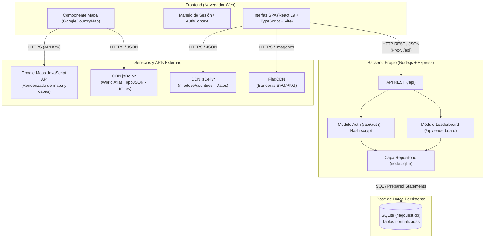
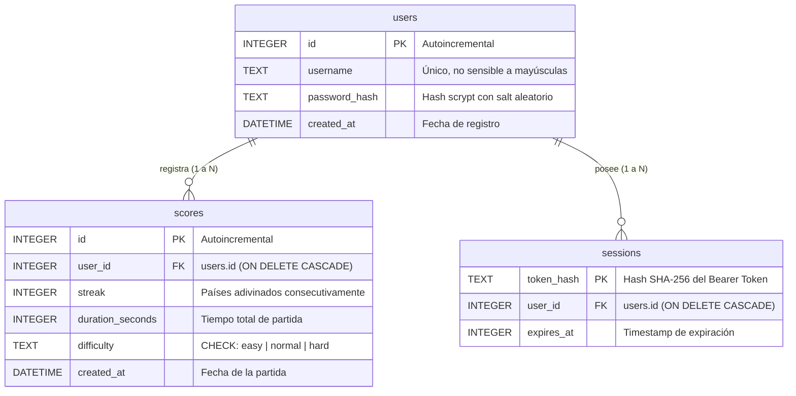

# FlagQuest 🌍🚩

> **Proyecto Integrador — Práctica Profesional 4 (PP4)**  
> **Carrera:** Tecnicatura Superior en Desarrollo de Software — IFTS 18  
> **Cátedra:** Prof. Alberto Campagna  
> **Ciclo Lectivo:** 2026  

---

## 📋 Índice
1. [Descripción del Proyecto](#-descripción-del-proyecto)
2. [Propósito y Problemática Abordada](#-propósito-y-problemática-abordada)
3. [Mecánicas del Juego](#-mecánicas-del-juego)
   - [Dificultades y Balance](#dificultades-y-balance)
   - [Sistema de Pistas Geográficas](#sistema-de-pistas-geográficas)
   - [Gestión de Partidas y Usuarios](#gestión-de-partidas-y-usuarios)
4. [Arquitectura del Sistema (Full Stack)](#-arquitectura-del-sistema-full-stack)
   - [Diagrama de Arquitectura y Red](#diagrama-de-arquitectura-y-red)
   - [Stack Tecnológico](#stack-tecnológico)
   - [Consumo de APIs y Fuentes de Datos](#consumo-de-apis-y-fuentes-de-datos)
5. [Base de Datos y Persistencia](#-base-de-datos-y-persistencia)
   - [Diseño y Normalización](#diseño-y-normalización)
   - [Diagrama Entidad-Relación (DER)](#diagrama-entidad-relación-der)
   - [Operaciones ABM / CRUD](#operaciones-abm--crud)
6. [Seguridad y Autenticación](#-seguridad-y-autenticación)
7. [Especificación de la API REST](#-especificación-de-la-api-rest)
8. [Instalación y Puesta en Marcha](#-instalación-y-puesta-en-marcha)
9. [Proyecciones y Roadmap (MVP)](#-proyecciones-y-roadmap-mvp)

---

## 📖 Descripción del Proyecto

**FlagQuest** es una aplicación web interactiva *Full Stack* de trivia geográfica y exploración cartográfica. Combina el reconocimiento visual de banderas nacionales con la ubicación precisa en un mapa mundial interactivo, integrando datos satelitales, límites fronterizos y cálculo espacial.

El juego propone un desafío dinámico: se presenta la bandera oficial de un país del mundo y el jugador debe localizar y hacer clic sobre su territorio en el mapa antes de agotar su margen de errores o perder su racha de aciertos.

---

## 🎯 Propósito y Problemática Abordada

El aprendizaje de la geografía política a menudo sufre de métodos pedagógicos estáticos, memorísticos y desconectados del contexto espacial real. Muchas personas reconocen los nombres o las banderas de diversos países, pero desconocen su localización geográfica, sus países limítrofes o sus dimensiones relativas.

**FlagQuest** soluciona esta brecha mediante **gamificación aplicada**:
* Fomenta la retención mediante interacción espacial activa (clic sobre coordenadas geográficas y polígonos reales).
* Provee retroalimentación inmediata calculando relaciones espaciales (mismo continente, frontera compartida, distancia en kilómetros mediante fórmula de Haversine).
* Motiva la superación personal y la competencia constructiva a través de un ranking global persistente (*Leaderboard*).

---

## 🎮 Mecánicas del Juego

### Dificultades y Balance

El juego cuenta con tres niveles de dificultad balanceados para distintos perfiles de usuario:

| Nivel | Nombres en Mapa | Pistas Geográficas | Límite de Errores | Objetivo Pedagógico |
| :--- | :---: | :---: | :---: | :--- |
| **Fácil (F)** | Visibles | Activas (distancia / fronteras) | 5 errores | Introductorio y de aprendizaje guiado |
| **Normal (N)** | Visibles | Desactivadas | 4 errores | Desafío estándar de búsqueda y agilidad |
| **Difícil (D)** | Ocultos | Desactivadas | 5 errores | Dominio avanzado y memoria cartográfica pura |

### Sistema de Pistas Geográficas
En modo **Fácil**, ante una respuesta incorrecta, el motor calcula pistas automáticas:
* **Pertenencia continental:** Indica si el país seleccionado y el objetivo comparten o no continente.
* **Adyacencia fronteriza:** Detecta si el país clicado limita directamente con el objetivo (utilizando códigos alfa-3 de fronteras).
* **Aproximación por distancia (Haversine):** Calcula la distancia ortodrómica en kilómetros entre ambos centroides (`< 1000 km` muy cerca, `1000 - 5000 km` intermedia, `> 5000 km` muy lejos).

### Gestión de Partidas y Usuarios
* **Modo Invitado:** Cualquier visitante puede jugar sin registrarse para probar la aplicación. Al finalizar, se le notifica que para competir en el ranking debe iniciar sesión.
* **Modo Registrado:** Los jugadores autenticados registran automáticamente su racha (*streak*), tiempo transcurrido y dificultad en la base de datos persistente.
* **Control ABM de Leaderboard:** Cada jugador autenticado tiene la facultad de eliminar sus propios puntajes del ranking desde la interfaz.

---

## 🏗 Arquitectura del Sistema (Full Stack)

La aplicación implementa una arquitectura desacoplada de dos capas (Cliente - Servidor) con persistencia relacional local y consumo de servicios distribuidos en la nube.

### Diagrama de Arquitectura y Red



### Stack Tecnológico

* **Frontend:**
  * **React 19:** Biblioteca base para interfaces basadas en componentes y estado reactivo.
  * **TypeScript:** Tipado estático robusto para entidades de dominio, retos geográficos y respuestas de API.
  * **Vite 8:** Entorno de desarrollo ultrarrápido y empaquetador para producción.
  * **Google Maps JavaScript API (`@googlemaps/js-api-loader`):** Motor de renderizado cartográfico interactivo, estilos de mapa personalizados y capas vectoriales GeoJSON.
  * **TopoJSON Client:** Decodificación y conversión de geometrías topológicas compactas a GeoJSON estándar para dibujar los límites de cada nación.
  * **CSS3 Responsive:** Maquetado con paleta temática, variables CSS y *media queries* adaptadas a pantallas de escritorio, tablets y smartphones.

* **Backend:**
  * **Node.js (v22+ / v26):** Entorno de ejecución con soporte nativo de tipos y motor SQLite integrado.
  * **Express 5:** Servidor HTTP para la exposición de endpoints RESTful.
  * **CORS:** Middleware para la comunicación segura entre orígenes.

### Consumo de APIs y Fuentes de Datos
1. **Google Maps API:** Proveedor de mapas vectoriales interactivos, soporte de eventos de puntero y zoom dinámico.
2. **World Atlas TopoJSON:** Dataset optimizado de límites fronterizos internacionales (resolución 1:50m).
3. **mledoze/countries API:** Repositorio en línea de datos soberanos con traducciones oficiales al español, capitales, coordenadas y códigos ISO 3166-1 (alfa-2, alfa-3 y numéricos).
4. **FlagCDN:** Red de entrega de banderas vectoriales y mapas de bits de alta resolución.
5. **API REST Interna:** Endpoints propios para autenticación y persistencia de marcadores.

---

## 🗄 Base de Datos y Persistencia

Para la persistencia de datos se seleccionó **SQLite**, aprovechando el módulo nativo de alto rendimiento `node:sqlite` (`DatabaseSync`). Esta decisión permite contar con una base de datos relacional SQL completa, portable, sin dependencias nativas externas y que almacena los datos en un archivo físico (`server/data/flagquest.db`).

### Diseño y Normalización
El modelo de datos cumple con la **Tercera Forma Normal (3FN)**:
* Se separan las entidades independientes (**Usuarios**) de sus eventos transaccionales (**Partidas/Puntuaciones**) y de los estados de acceso (**Sesiones**).
* Cada registro de puntaje y de sesión se vincula con la tabla `users` mediante claves foráneas (`FOREIGN KEY`) con regla de integridad referencial `ON DELETE CASCADE`.
* Se crearon índices específicos para optimizar las consultas de ordenamiento y filtrado por dificultad (`idx_scores_difficulty`, `idx_scores_user`) e índices insensibles a mayúsculas para nombres de usuario (`idx_users_username_nocase`).

### Diagrama Entidad-Relación (DER)



### Operaciones ABM / CRUD
El sistema implementa el ciclo completo de operaciones requeridas:
* **Alta (Create):** 
  * Registro de nuevo usuario en `users`.
  * Inserción de nueva partida en `scores`.
  * Creación de token de sesión en `sessions`.
* **Baja (Delete):**
  * Eliminación de partidas individuales del ranking por parte de su autor (`DELETE /api/leaderboard/:id`).
  * Cierre de sesión y revocación de token (`DELETE /api/auth/logout`).
  * Purga automática de sesiones vencidas según `expires_at`.
* **Modificación (Update):**
  * Control y actualización de estado en repositorios de usuarios.
* **Consulta (Read):**
  * Obtención del ranking por dificultad mediante `JOIN` entre `scores` y `users` con ordenamiento compuesto (`streak DESC, duration_seconds ASC`).
  * Validación de credenciales e identidad del usuario activo (`/api/auth/me`).

---

## 🔒 Seguridad y Autenticación

El sistema implementa buenas prácticas de seguridad informática en el ciclo de vida del usuario:
* **Protección de Contraseñas:** Se utiliza la función de derivación de claves **`scrypt`** provista por `node:crypto`, combinada con un *salt* criptográfico aleatorio de 16 bytes. Las contraseñas nunca se persisten en texto plano.
* **Prevención de Timing Attacks:** La validación de hashes utiliza `crypto.timingSafeEqual` para prevenir ataques de temporización de canal lateral.
* **Gestión de Sesiones Segura:** Los tokens de sesión son cadenas criptográficamente aleatorias (`base64url`). En la base de datos no se guarda el token plano, sino su hash `SHA-256`.
* **Autorización:** Para registrar un puntaje o eliminar una partida, se verifica el encabezado `Authorization: Bearer <token>` contra la sesión activa del usuario.

---

## 📡 Especificación de la API REST

### Autenticación (`/api/auth`)

| Método | Endpoint | Descripción | Requiere Auth |
| :--- | :--- | :--- | :---: |
| `POST` | `/api/auth/register` | Crea una nueva cuenta y retorna token | No |
| `POST` | `/api/auth/login` | Valida credenciales y retorna token | No |
| `GET` | `/api/auth/me` | Obtiene los datos del usuario autenticado | Sí (Bearer) |
| `POST` | `/api/auth/logout` | Revoca la sesión activa | Sí (Bearer) |

### Puntuaciones / Leaderboard (`/api/leaderboard`)

| Método | Endpoint | Parámetros / Cuerpo | Descripción | Requiere Auth |
| :--- | :--- | :--- | :--- | :---: |
| `GET` | `/api/leaderboard` | `?difficulty=easy\|normal\|hard` | Retorna los 10 mejores puntajes ordenados | No |
| `POST` | `/api/leaderboard` | `{ streak, durationSeconds, difficulty }` | Registra una partida completada | Sí (Bearer) |
| `DELETE` | `/api/leaderboard/:id` | `id` en la ruta | Elimina una partida (sólo el propietario) | Sí (Bearer) |

---

## 🚀 Instalación y Puesta en Marcha

### Prerrequisitos
* **Node.js** v22.5 o superior (incluye `node:sqlite`).
* **npm** v10 o superior.
* Conexión a internet (para cargar mapas y datos de países).

### 1. Clonar el Repositorio
```bash
git clone <URL_DEL_REPOSITORIO>
cd proyecto_final
```

### 2. Configurar Variables de Entorno
Crear un archivo `.env.local` en la raíz del proyecto (basado en `.env.example`):
```env
VITE_GOOGLE_MAPS_API_KEY=AIzaSy...tu_clave_de_google_maps
```

### 3. Ejecución en un solo paso
El proyecto incluye un script ejecutable que instala dependencias y levanta simultáneamente el servidor backend y el frontend:
```bash
chmod +x run.sh
./run.sh
```

El script iniciará:
* **Servidor Backend (Express + SQLite):** `http://localhost:3001`
* **Cliente Frontend (Vite + React):** `http://localhost:5173`

*(Al presionar `Ctrl + C`, ambos servicios se detendrán ordenadamente).*

---

## 🔮 Proyecciones y Roadmap (MVP)

De acuerdo con los objetivos del Producto Mínimo Viable (MVP) evaluados en la rúbrica del proyecto, se planifican las siguientes mejoras evolutivas para futuras versiones:

- [ ] **Modo Multijugador en Tiempo Real:** Implementación de salas competitivas simultáneas mediante WebSockets (`Socket.io`), donde varios jugadores compiten por ubicar la misma bandera antes que sus rivales.
- [ ] **Filtros Cartográficos por Continente o Región:** Posibilidad de crear partidas personalizadas acotadas a América, Europa, África, Asia u Oceanía.
- [ ] **Desafíos Diarios (Daily FlagQuest):** Una secuencia idéntica de banderas para todos los jugadores del mundo que se reinicia cada 24 horas.
- [ ] **Sistema de Logros e Insignias:** Medallas desbloqueables por hitos (ej. "Racha de 20 aciertos", "Maestro de África", "Partida Impecable").
- [ ] **Modo de Práctica Libre (Exploración):** Modo sin límite de tiempo ni vidas para explorar el mapa interactivo y estudiar datos demográficos de cada país al hacer clic.
